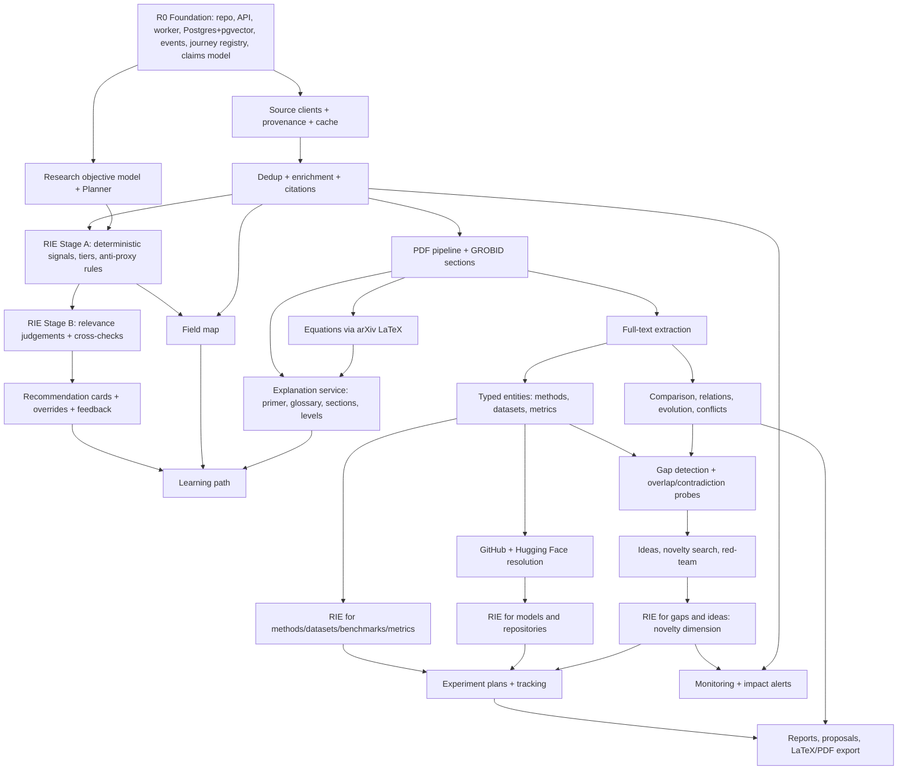

# Implementation Roadmap

**Status:** canonical. It supersedes `docs/plan/09` and `docs/plan/14`.

## 1. Repository audit (as of 2026-11-10)

### 1.1 What exists
| Area | Status |
|---|---|
| Source code (backend, frontend) | **None.** No Python, TypeScript or configuration files |
| Database models / migrations | **None** |
| API endpoints | **None** (designed in `docs/plan/05-api.md`) |
| Agent implementations | **None** (designed in docs) |
| Tests / CI | **None** |
| Docker / deployment | **None** |
| Documentation | `README.md`; 15 planning documents in `docs/plan/` (two planning rounds); this set of nine canonical documents in `docs/` |

The only branch is `claude/eloquent-galileo-cmyek5`, with two commits, both
documentation. Everything below is therefore a comparison of the **plan**
against the full vision. There is no code to refactor.

### 1.2 Plan coverage against the full vision
| Vision area | Covered in earlier plan | Missing before this revision |
|---|---|---|
| DISCOVER | Detailed (Milestone 1) | Objective model; seeds chosen by usefulness rather than citations |
| LEARN | Designed in v2 (primer, glossary, path, levels) | Learning resources chosen by RIE |
| UNDERSTAND | Designed (full text, extraction, field map) | Typed dataset/model attributes |
| **FILTER** | **Not a stage**; a single relevance score + date/citation roles | **Research Intelligence Engine** (dimensions, cards, tiers, overrides, feedback) |
| COMPARE | Designed | Resource comparisons via cards |
| INVESTIGATE | Designed (gap pipeline) | Contradiction probes (added in v2), gap assessment by RIE |
| VALIDATE | Designed | Idea assessment by RIE |
| EXPERIMENT | Partly (Phase 5 links) | Constraint-aware resource selection; experiment tracking |
| PROPOSE | Designed (reports) | — |
| Verification of classifications | Quote/citation checks only | Signal provenance, cross-checks, calibration, claim verification levels |
| Evaluation | Extraction eval only | Gold sets for relevance, explanations, structure; beat-the-proxy test; release gates |
| Costs & free operation | Not estimated | Cost model; free-source mode |

Weaknesses in the earlier plan and their fixes are listed in
[ARCHITECTURE §5](ARCHITECTURE.md#5-weaknesses-of-the-previous-plan-and-how-this-version-addresses-them).

## 2. Feature dependency graph

The critical path to the MVP is
F0 → D1 → D2 → OBJ/RA → RB → CARD → (FM, PDF → EXPL) → LP.

## 3. Releases

| Release | Theme | Journey stages served |
|---|---|---|
| **R0** | Foundation | — |
| **R1 (MVP)** | Discover, Filter & Learn | DISCOVER, FILTER (papers), LEARN, UNDERSTAND (reading) |
| **R2** | Understand & Compare | UNDERSTAND (full), COMPARE, FILTER (methods/datasets/benchmarks/metrics) |
| **R3** | Investigate & Validate | INVESTIGATE, VALIDATE |
| **R4** | Experiment & Propose | EXPERIMENT, PROPOSE |
| **R5** | Persist & Monitor | all (long-term) |

### Why this MVP
- It delivers the critical new requirement (objective-aware usefulness with
  explanations and overrides) and the beginner positioning (primer, glossary,
  path, read-with-me).
- It builds the foundations every later release reuses: research record,
  provenance, RIE core, claims and verification, explanation service, PDF
  pipeline, events and journey registry.
- It works for experts too: a deduplicated, cited, objective-ranked collection
  with reasons, overrides and a field map.
- Its core runs on free sources. The LLM adds depth, but the MVP isn't
  useless without it.

R1 ships in three internal milestones so value appears early:
**M1a Discover** → **M1b Filter** → **M1c Learn**.

## 4. Phase tasks and acceptance tests

Acceptance tests have IDs. "(E)" means the test is defined in
EVALUATION_FRAMEWORK.

### R0 — Foundation
**Tasks**
1. Monorepo scaffold: `backend/` (uv, Python 3.12, ruff, mypy, pytest), `frontend/` (Vite, React, TS, Tailwind, TanStack Query), pre-commit, `.env.example`.
2. Settings, structured logging with secret filtering, problem+json errors, health endpoints.
3. Postgres 16 + pgvector + pg_trgm; Alembic; tables: users, projects, research_items, research_runs, task_executions, run_events, checkpoints, domain_events, claims (+evidence, verifications).
4. Postgres job queue + worker; LangGraph Postgres checkpointer; SSE via LISTEN/NOTIFY.
5. Event outbox writer and dispatcher (idempotent consumers).
6. Journey registry with the nine stages (readiness stubs) and `GET /projects/{id}/journey`.
7. Frontend shell: layout, journey bar, dashboard, new-project form (topic, level, goal), run progress view.
8. Docker Compose (postgres, grobid, api, worker, frontend); CI (lint, types, tests, build).

**Acceptance tests**
- R0-1 `make up` from a clean clone starts all services with healthy checks.
- R0-2 `/health/ready` returns 200 only when Postgres is reachable; otherwise problem+json 503.
- R0-3 A dummy workflow streams events to the UI, pauses at a checkpoint, survives a worker restart and resumes after approval.
- R0-4 An event written in a rolled-back transaction is never dispatched; a consumer that fails is retried and is idempotent.
- R0-5 Logs never contain configured secret values (test).
- R0-6 Migrations upgrade from empty and downgrade cleanly.
- R0-7 Journey endpoint returns nine stages with deterministic states for a fixture project.

### R1 — MVP: Discover, Filter & Learn

**M1a Discover — tasks**
1. Identifier parsing/normalisation (DOI, arXiv old/new, S2, OpenAlex) with property tests.
2. `SourceClient` base: rate limits, retries, circuit breaker, HTTP cache, source records, usage budgets.
3. Clients: arXiv, Semantic Scholar, OpenAlex (optional, budgeted), Crossref; integration docs with verified-on dates.
4. Paper tables, dedup (identifier union-find + conservative fuzzy), enrichment, citations, survey detection.
5. Research objective model + Planner (LLM) + rule-based fallback; objective editor UI.
6. Discovery workflow W1 with plain-language checkpoints; search log; manual add by identifier.

**M1b Filter — tasks**
7. Signal plugin framework; Stage A paper signals (semantic match, focus/exclusion coverage, in-corpus citation share, co-citation, intents, field-normalised citations with cap, survey flag, currency).
8. Scoring, objective profiles, tiers, role tags, anti-proxy rules; assessment history; staleness via events.
9. Stage B: Relevance Judge with verified quotes; cross-check runner; top-K control; budget accounting (`llm_usage`).
10. Card skeleton builder + Card Writer + ClaimValidator; card cache; "How was this ranked?".
11. Overrides, feedback, decision log, objective suggestions, bounded weight adaptation.
12. Filter/Triage UI with beginner and advanced views; seed selection for citation expansion uses Stage A priority.

**M1c Learn — tasks**
13. Field Mapper (embeddings + citation communities, keyword labels, optional LLM labels) and field map UI.
14. PDF pipeline: resolver chain (arXiv, S2 OA, OpenAlex OA, Unpaywall, upload), downloader, GROBID sections, chunks + embeddings; precise failure reasons.
15. Explanation service (on-demand, cached, streamed) + Tutor: primer, glossary definitions, section explanations; grounded/background labelling; level switch.
16. Term Miner + glossary UI with "appears in" links.
17. Curriculum Builder + learning path UI with progress.
18. Read-with-me UI; reading status, notes, saved items, project history.
19. Discovery report (Markdown) and BibTeX/CSV export.
20. Evaluation harness, G-TOPICS, G-DEDUP, G-RELEVANCE (first 5 topics), G-EXPLAIN (R1 subset); usability round.

**Acceptance tests**
- R1-1 End-to-end run in fixture mode and live mode for 5 reference topics, from the three-field start to filtered collection, primer and learning path.
- R1-2 One canonical paper when the same work arrives from arXiv, S2 and OpenAlex; dedup precision/recall targets met (E §3.1).
- R1-3 Every query, source response, failure and cache hit is recorded; the run is replayable from cache with the same item set.
- R1-4 Rate-limit tests: arXiv ≤ 1 req/3 s; `Retry-After` honoured; a failing source is marked degraded and the run ends `partially_succeeded` with a coverage notice.
- R1-5 With no LLM key: discovery, Stage A tiers (capped at Recommended), card skeletons, field map with keyword labels, glossary term list and reading UI all work; LLM-only features show a clear "not available" message.
- R1-6 **Anti-proxy:** property test — items with only citation and date signals never reach Essential or Recommended; changing content signals with fixed citations changes ranking.
- R1-7 **Beat-the-proxy (E §3.2):** RIE nDCG@20 exceeds citation-only, recency-only and similarity-only rankings on every held-out topic.
- R1-8 Essential precision ≥ 0.85 and Not-useful precision ≥ 0.90 on held-out topics (E).
- R1-9 Every card has all six fields (or an explicit "none found" plus a missing-info entry); every Reported/Extracted statement verifies; every grounded AI statement references valid evidence.
- R1-10 High-stakes judgements are cross-checked; a disagreement produces an "uncertain" label and lower confidence (fixture test).
- R1-11 Overrides persist across recomputes; a later system change produces a non-blocking notice; overrides appear in the decision log and exports.
- R1-12 After 20 fixture overrides, weight adaptation stays within ±50% of defaults, is shown to the user and can be undone; no change happens before the threshold.
- R1-13 "Wrong" feedback hides the statement immediately and creates a review record.
- R1-14 Second request for the same (subject, level) explanation is served from cache with no LLM call; sections never opened are never explained.
- R1-15 Background explanations containing paper names, citations or results not in the project are rejected (adversarial suite).
- R1-16 Unavailable full text shows a one-sentence reason and an upload option; the explanation is labelled "Based on the abstract only".
- R1-17 Field map: 3–8 directions per reference topic, each ≥ 3 papers, with basis recorded; deterministic with fixed seeds.
- R1-18 Glossary ≥ 15 terms per topic, each linked to ≥ 1 verified span; learning path never violates recorded prerequisites.
- R1-19 Default screens pass the banned-jargon scan; progress messages within 2 s and every ≤ 10 s.
- R1-20 Honesty gates (E §3.3) pass with zero tolerance.
- R1-21 Usability: ≥ 4 of 5 beginners complete the journey without help and pass the comprehension check; 3 experts review their own topic, and any fabrication is release-blocking.
- R1-22 Playwright e2e: create → confirm objective → review set → open card → override → read primer → open path paper → explain a section at two levels → find it in history.

### R2 — Understand & Compare
**Tasks:** Extractor (contributions, methods, datasets, metrics, results, limitations, assumptions, protocols, compute) with quote verification and Batches API option; typed entity normalisation + detail tables; arXiv LaTeX source + equation explainer; algorithm explainer; exercises (not run); Comparator (tables, `paper_relations`, evolution, conflicts with comparability); field map v2 (methods/datasets per direction, taxonomy); RIE signals for papers using full text, plus RIE for methods, datasets, benchmarks and metrics; resources UI; G-EXTRACT and G-RESOURCES evaluation.

**Acceptance tests**
- R2-1 Extraction targets met on G-EXTRACT (E §3.6); 100% of persisted extractions have verified evidence.
- R2-2 Every `reported_results.value_text` appears inside its evidence quote.
- R2-3 Equation explanations quote the paper's symbol definitions when present and label inferred ones; non-arXiv equations come only from user selection.
- R2-4 Comparison cells link to evidence or show "not reported"; conflicts show a comparability check (split, setting, backbone).
- R2-5 Dataset and metric cards show licence and access only from metadata (never LLM-inferred); a missing licence appears in missing information.
- R2-6 Dimension agreement κ ≥ 0.6 with full text (E §3.2); paper tiers re-evaluated after extraction, with tier changes notified.
- R2-7 Exercises always display "not run".

### R3 — Investigate & Validate
**Tasks:** limitation clustering (independent-group rule), intersection matrices, conflict-derived gaps; Novelty Search service; overlap and contradiction probes; Gap Investigator; RIE for gaps; hypotheses with falsification criteria; Red-Team Reviewer with revise loop; RIE for ideas (novelty dimension) and novelty-implication signals on papers; idea status tracking; gap and idea UIs; G-GAPS evaluation.

**Acceptance tests**
- R3-1 Every gap stores reproducible signals and has both an overlap probe and a contradiction probe with recorded queries.
- R3-2 The gap view shows evidence for and against side by side; "already addressed" links the addressing work with a quote.
- R3-3 Every idea links to its gap, evidence for and against, a novelty check (queries, sources, date, nearest work) and ≥ 1 red-team review.
- R3-4 No output contains banned novelty phrasings (automated scan).
- R3-5 Papers gain "closest prior work / supports / challenges" novelty tags against user ideas, with quotes.
- R3-6 Gap reality and probe adequacy targets met (E §3.7).
- R3-7 Idea status changes are logged with reasons.

### R4 — Experiment & Propose
**Tasks:** GitHub and Hugging Face resolution with link confidence; RIE for models and repositories (constraint-aware: licence, size vs. compute, activity); experiment plans (datasets, baselines, metrics, protocols, ablations, compute from `compute_reports` only); experiment tracking with user-reported results; Writer; literature review and proposal reports; Citation Validator; LaTeX/PDF/BibTeX/RIS export.

**Acceptance tests**
- R4-1 Code links show link source and confidence; name-search-only matches are labelled "possible".
- R4-2 Compute estimates appear only when backed by `compute_reports`; otherwise "insufficient information".
- R4-3 Ablation suggestions are labelled AI interpretation and reference named method components.
- R4-4 User-reported results are never shown alongside paper-reported results without a distinguishing label.
- R4-5 100% of report citations resolve to project papers; factual sentences without citations are blocked or removed.
- R4-6 LaTeX export compiles in CI; references include DOI / arXiv ID / URL where known.

### R5 — Persist & Monitor
**Tasks:** scheduled monitors; impact detection against open gaps, accepted ideas and running experiments; incremental re-assessment; authentication and multi-user; optional sandboxed exercise execution; optional Qdrant/Neo4j adapters; backups and runbook.

**Acceptance tests**
- R5-1 Monitors are idempotent and notify only on new canonical papers.
- R5-2 Every impact alert contains the new paper, the affected item and the overlapping passage; dismissals are logged.
- R5-3 Re-assessment after new papers reuses prior signals and reports which tiers changed.

## 5. Free-source plan

| Built first with free sources only | Needs an LLM (paid API or local model) |
|---|---|
| Discovery from arXiv, Semantic Scholar (free key), Crossref, Unpaywall; OpenAlex within its free allowance (optional) | Planner drafting objectives and queries (a form is the fallback) |
| Dedup, enrichment, citation graph, survey detection | Relevance judgements (Stage B) |
| RIE Stage A: deterministic signals, tiers (capped), role tags, missing information | Card prose, primer, definitions, explanations |
| Card skeletons (extracted statements, signals, missing information) | Curriculum ordering beyond role-based ordering |
| Field map with keyword labels | Extraction, comparisons, gaps, ideas, red-team, proposals |
| PDF retrieval, GROBID sections, read-with-me (without explanations) | Equation and algorithm explanations, exercises |
| Glossary term list with "appears in" links | |
| Overrides, notes, decisions, history, exports | |
| GitHub and Hugging Face metadata (R4) | |

Order of work inside R1 follows this split: every free capability is built
before the LLM layer that enriches it.

## 6. Main technical risks

| # | Risk | Likelihood | Impact | Mitigation |
|---|---|---|---|---|
| T1 | RIE rankings not better than simple proxies | Medium | High (core promise) | Beat-the-proxy release gate; gold sets before tuning; signals visible for debugging |
| T2 | LLM judgements or explanations wrong but plausible | High | High | Verified quotes, cross-checks, claim kinds, background restrictions, feedback hiding, human evaluation gates |
| T3 | Gold-set annotation effort underestimated | High | Medium | Start with 5 topics; recruit domain volunteers early; write guidelines first |
| T4 | API access changes (OpenAlex pricing, S2 limits) | Medium | Medium | Optional sources, budgets, cache, per-source coverage reporting |
| T5 | Low full-text availability outside CS/physics | High | Medium | Abstract-only mode clearly labelled; uploads; Unpaywall |
| T6 | LLM cost per project higher than estimated | Medium | Medium | `llm_usage` tracking from day one; top-K limits; on-demand cards; caching; batch for extraction; per-project budget |
| T7 | Scope creep across nine stages | High | High | Release gates; MVP limited to papers in FILTER; other item types later |
| T8 | Beginners overwhelmed despite levels | Medium | High | Usability rounds in R1; banned-jargon test; one next step at a time |
| T9 | Licensing (PyMuPDF AGPL if adopted; CC-BY-SA dumps; publisher PDFs) | Low–Medium | Medium | GROBID + pypdfium2; store licences; no redistribution of PDFs |
| T10 | Clustering instability makes field maps change between runs | Medium | Low | Fixed seeds; stability tracked; user-pinned directions later |

## 7. Decisions needed before coding

| # | Decision | Recommendation |
|---|---|---|
| D1 | LLM provider and models | Anthropic via a provider-agnostic gateway; `claude-opus-5-5` default for all tasks; per-task overrides only after evaluation shows quality holds |
| D2 | PDF text library | GROBID + pypdfium2 (avoid AGPL PyMuPDF) |
| D3 | Job queue | Postgres-backed queue; no Redis in the MVP |
| D4 | Embeddings | Local open model (no API cost); version recorded |
| D5 | Auth | Single user until R5; `user_id` columns from day one |
| D11 | OpenAlex | Optional, with a daily budget; free core works without it |
| D12 | Vector store | pgvector behind an interface |
| D13 | Graph store | Postgres + networkx; Neo4j deferred |
| D18 | MVP scope | R1 = Discover, Filter (papers) & Learn, in milestones M1a/M1b/M1c |
| D19 | Gold-set annotators | Who annotates the 5 initial topics (needed before M1b is tuned) |
| D20 | RIE default weights and thresholds | Start with the profiles in RIE §5.2; calibrate on G-RELEVANCE before release |
