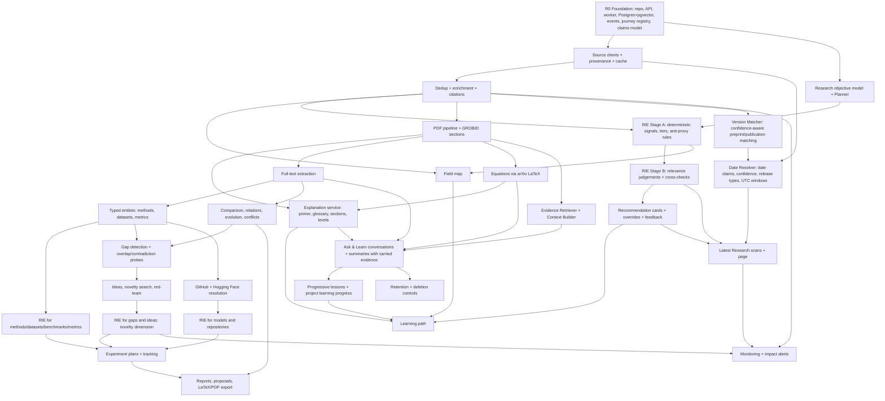

# Implementation Roadmap

**Status:** canonical. It supersedes `docs/plan/09` and `docs/plan/14`.

## 1. Repository audit (as of 2026-11-10, re-checked for the Latest Research / Ask & Learn update)

### 1.1 What exists
| Area | Status |
|---|---|
| Source code (backend, frontend) | **None.** No Python, TypeScript or configuration files |
| Database models / migrations | **None** |
| API endpoints | **None** (designed in `docs/plan/05-api.md`) |
| Agent implementations | **None** (designed in docs) |
| Tests / CI | **None** |
| Docker / deployment | **None** |
| Documentation | `README.md`; 15 planning documents in `docs/plan/` (two planning rounds); this set of nine canonical documents in `docs/` |

The only branch is `claude/eloquent-galileo-cmyek5`. All of its commits are
documentation; no application code has been added since. Everything below is therefore a comparison of the **plan**
against the full vision. There is no code to refactor.

### 1.2 Plan coverage against the full vision
| Vision area | Covered in earlier plan | Missing before this revision |
|---|---|---|
| DISCOVER | Detailed (Milestone 1) | Objective model; seeds chosen by usefulness rather than citations |
| LEARN | Designed in v2 (primer, glossary, path, levels) | Learning resources chosen by RIE |
| UNDERSTAND | Designed (full text, extraction, field map) | Typed dataset/model attributes |
| **FILTER** | **Not a stage**; a single relevance score + date/citation roles | **Research Intelligence Engine** (dimensions, cards, tiers, overrides, feedback) |
| COMPARE | Designed | Resource comparisons via cards |
| INVESTIGATE | Designed (gap pipeline) | Contradiction probes (added in v2), gap assessment by RIE |
| VALIDATE | Designed | Idea assessment by RIE |
| EXPERIMENT | Partly (Phase 5 links) | Constraint-aware resource selection; experiment tracking |
| PROPOSE | Designed (reports) | — |
| Verification of classifications | Quote/citation checks only | Signal provenance, cross-checks, calibration, claim verification levels |
| Evaluation | Extraction eval only | Gold sets for relevance, explanations, structure; beat-the-proxy test; release gates |
| Costs & free operation | Not estimated | Cost model; free-source mode |
| Latest Research | Only "latest" as a paper role inside discovery (by date) | Dedicated page, date provenance, release types, recurring scans |
| Ask & Learn | One-shot explanations only | Conversations, context, scope, styles, follow-ups, prerequisites, saving |

Weaknesses in the earlier plan and their fixes are listed in
[ARCHITECTURE §5](ARCHITECTURE.md#5-weaknesses-of-the-previous-plan-and-how-this-version-addresses-them).

## 2. Feature dependency graph

The critical path to the MVP is
F0 → D1 → D2 → OBJ/RA → RB → CARD → LAT, then (FM, PDF → RET → EXPL/ASK) → LP.
Latest Research depends on the Date Resolver and RIE, but not on full text.
Ask & Learn depends on the PDF pipeline and retrieval; it gains equations
(EQ) and multi-paper comparisons (EXT) in R2 without redesign.

## 3. Releases

| Release | Theme | Journey stages served |
|---|---|---|
| **R0** | Foundation | — |
| **R1 (MVP)** | Discover, Filter & Learn | DISCOVER, FILTER (papers), LEARN, UNDERSTAND (reading) · **Latest Research** · **Ask & Learn v1** |
| **R2** | Understand & Compare | UNDERSTAND (full), COMPARE, FILTER (methods/datasets/benchmarks/metrics) |
| **R3** | Investigate & Validate | INVESTIGATE, VALIDATE |
| **R4** | Experiment & Propose | EXPERIMENT, PROPOSE |
| **R5** | Persist & Monitor | all (long-term); scheduled Latest Research scans + notifications |

### Why this MVP
- It delivers the critical new requirement (objective-aware usefulness with
  explanations and overrides) and the beginner positioning (primer, glossary,
  path, read-with-me).
- It builds the foundations every later release reuses: research record,
  provenance, RIE core, claims and verification, explanation service, PDF
  pipeline, events and journey registry.
- It works for experts too: a deduplicated, cited, objective-ranked collection
  with reasons, overrides and a field map.
- Its core runs on free sources. The LLM adds depth, but the MVP isn't
  useless without it.

- Latest Research and Ask & Learn are mostly reuse. Latest Research is the
  discovery workflow with date bounds plus the RIE. Ask & Learn replaces the
  earlier one-shot section explainer with a conversation on the same Tutor.
  Adding them to R1 costs one milestone, not a release.

R1 ships in four internal milestones so value appears early:
**M1a Discover** → **M1b Filter** → **M1c Latest Research** → **M1d Learn & Ask**.

### Implementation order (after approval)
1. **R0 Foundation:** two PRs (scaffold + DB/migrations; API/worker/SSE/frontend shell/compose).
2. **M1a Discover:** identifiers → SourceClient → clients (arXiv, S2, OpenAlex basic, Crossref, bioRxiv/medRxiv) → paper tables + Version Matcher + G-MATCH → Date Resolver (D28) + UTC/time-zone handling + G-LATEST-DATES → objective + Planner → discovery workflow.
3. **M1b Filter:** signals → scoring/tiers/anti-proxy → Stage B + cross-checks → cards + validator → overrides/feedback → triage UI.
4. **M1c Latest Research:** scan planner + W8 → abstract-mode extraction, relation_to_project, linker, Action Recommender → Latest brief + digest → page.
5. **M1d Learn & Ask:** field map → PDF pipeline → retrieval + context builder → Tutor answer mode + conversations + summaries → progressive teaching + progress → saved explanations → retention → glossary + learning path → read-with-me.
6. Evaluation sets in parallel from M1a. Usability round. R1 release gates (EVALUATION_FRAMEWORK §6).

Within each milestone, the parts that work without an LLM are built and
tested before the LLM layer that enriches them.

## 4. Phase tasks and acceptance tests

Acceptance tests have IDs. "(E)" means the test is defined in
EVALUATION_FRAMEWORK.

### R0 — Foundation
**Tasks**
1. Monorepo scaffold: `backend/` (uv, Python 3.12, ruff, mypy, pytest), `frontend/` (Vite, React, TS, Tailwind, TanStack Query), pre-commit, `.env.example`.
2. Settings, structured logging with secret filtering, problem+json errors, health endpoints.
3. Postgres 16 + pgvector + pg_trgm; Alembic; tables: users, projects, research_items, research_runs, task_executions, run_events, checkpoints, domain_events, claims (+evidence, verifications).
4. Postgres job queue + worker; LangGraph Postgres checkpointer; SSE via LISTEN/NOTIFY.
5. Event outbox writer and dispatcher (idempotent consumers).
6. Journey registry with the nine stages (readiness stubs) and `GET /projects/{id}/journey`.
7. Frontend shell: layout, journey bar, dashboard, new-project form (topic, level, goal), run progress view.
8. Docker Compose (postgres, grobid, api, worker, frontend); CI (lint, types, tests, build).

**Acceptance tests**
- R0-1 `make up` from a clean clone starts all services with healthy checks.
- R0-2 `/health/ready` returns 200 only when Postgres is reachable; otherwise problem+json 503.
- R0-3 A dummy workflow streams events to the UI, pauses at a checkpoint, survives a worker restart and resumes after approval.
- R0-4 An event written in a rolled-back transaction is never dispatched; a consumer that fails is retried and is idempotent.
- R0-5 Logs never contain configured secret values (test).
- R0-6 Migrations upgrade from empty and downgrade cleanly.
- R0-7 Journey endpoint returns nine stages with deterministic states for a fixture project.

### R1 — MVP: Discover, Filter & Learn (+ Latest Research, Ask & Learn)

**M1a Discover — tasks**
1. Identifier parsing/normalisation (DOI, arXiv old/new, S2, OpenAlex) with property tests.
2. `SourceClient` base: rate limits, retries, circuit breaker, HTTP cache, source records, usage budgets.
3. Clients: arXiv, Semantic Scholar, OpenAlex (basic access, budgeted; `OPENALEX_CAPABILITIES` switch with both paths tested, D24), Crossref (incl. `relation` and `posted` fields), bioRxiv/medRxiv (`/details`, `/pubs`; D22); integration docs with verified-on dates.
4. Paper tables, dedup (identifier union-find), **Version Matcher** with `paper_match_decisions` (decisive / strong / supporting / contradicting evidence; possible matches linked, not merged; reversible merges; D29), enrichment, citations, survey detection. G-MATCH (first 300 pairs, incl. 100 adversarial) before tuning thresholds.
4a. Date provenance: `paper_dates` (role, manifestation, identifier), `paper_versions`, Date Resolver (claims, corroboration lookups, confidence incl. `corroborated`/`single_secondary` (D28), first public date, release-type rules), UTC storage and window computation with boundary-day flags (D23); user time zone preference and the `LocalTime` display component; table-driven tests from G-LATEST-DATES. Built here because every discovered paper stores its dates.
5. Research objective model + Planner (LLM) + rule-based fallback; objective editor UI.
6. Discovery workflow W1 with plain-language checkpoints; search log; manual add by identifier.

**M1b Filter — tasks**
7. Signal plugin framework; Stage A paper signals (semantic match, focus/exclusion coverage, in-corpus citation share, co-citation, intents, field-normalised citations with cap, survey flag, currency).
8. Scoring, objective profiles, tiers, role tags, anti-proxy rules; assessment history; staleness via events.
9. Stage B: Relevance Judge with verified quotes; cross-check runner; top-K control; budget accounting (`llm_usage`).
10. Card skeleton builder + Card Writer + ClaimValidator; card cache; "How was this ranked?".
11. Overrides, feedback, decision log, objective suggestions, bounded weight adaptation.
12. Filter/Triage UI with beginner and advanced views; seed selection for citation expansion uses Stage A priority.

**M1c Latest Research — tasks**
12a. Planner `LatestScanPlan` (per-subtopic queries, arXiv category mapping, bioRxiv/medRxiv category mapping for life-science objectives) and the Latest Scan Planner service; date-bounded source queries (arXiv `submittedDate` + category sweep; bioRxiv/medRxiv `/details` + `/pubs`; S2 date-range search; OpenAlex publication-date filter, plus created-date filter only when the premium capability is enabled; Crossref `from-pub-date` and DOI date confirmation).
12b. W8 Latest scan workflow; `latest_scans`, `latest_scan_entries`, `latest_views`; coverage and failure recording; refresh on open if older than 24 h.
12c. Relevance Judge `relation_to_project` (challenges cross-checked); Extractor abstract mode (incl. comparative statements and author-stated limitations/future work); Related Item Linker (cites vs similar); Action Recommender; Card Writer **Latest brief** (eight questions), "What's new" and digest mode.
12d. Latest Research page: window picker (local-time display), release-type tabs, eight-question briefs (beginner/advanced views), action chips with override, filters (incl. action), date provenance popover, possible-match prompts, entry actions (save, dismiss, read later, notes, Ask about this), "new since last visit".
12e. G-LATEST-DATES and G-LATEST-RELEVANCE (first 5 topics × 2 weeks of frozen responses).

**M1d Learn & Ask — tasks**
13. Field Mapper (embeddings + citation communities, keyword labels, optional LLM labels) and field map UI.
14. PDF pipeline: resolver chain (arXiv, S2 OA, OpenAlex OA, Unpaywall, upload), downloader, GROBID sections, chunks + embeddings; precise failure reasons.
15. Explanation service (on-demand, cached, streamed) + Tutor: primer, glossary definitions, section explanations; grounded/background labelling; level switch.
15a. Evidence Retriever (hybrid pgvector + full-text, scoped) and Context Builder (project + view context + memory within budget).
15b. Ask & Learn: `tutor_conversations`, `tutor_messages`, `tutor_message_evidence`, `conversation_summaries` (summary text + deterministically collected `carried_refs`); Scope Router; Tutor answer mode with seven styles and follow-up intents; `TutorAnswer` validation (grounding, not-found, equation rule, background restrictions, **no summary/assistant-message evidence**); saved explanations (independent copies); feedback; prerequisite offers → Curriculum Builder.
15b-2. **Progressive teaching:** `teaching_sessions`, `understanding_checks`, `concept_progress`; Tutor teaching mode (eight steps, lazy generation, skip reasons, simpler/deeper/jump, interrupt and resume); check grading; Learning Progress Tracker; progress on the Learn page and learning path.
15b-3. **Retention:** project retention policy, delete conversation / delete all / reset progress, Retention Enforcer daily job, cascade rules.
15c. Ask & Learn panel available on every page (context chips, scope switch, follow-up chips, sources, lesson stepper and controls); text selection → Ask; history, saved explanations and learning progress page; retention settings.
16. Term Miner + glossary UI with "appears in" links.
17. Curriculum Builder + learning path UI with progress.
18. Read-with-me UI (paper + Ask & Learn side by side); reading status, notes, saved items, project history.
19. Discovery report (Markdown) and BibTeX/CSV export.
20. Evaluation harness, G-TOPICS, G-DEDUP, G-RELEVANCE (first 5 topics), G-EXPLAIN (R1 subset), G-TUTOR (R1 subset: a, b, d, e, f, g); usability round including both new features.

**Acceptance tests**
- R1-1 End-to-end run in fixture mode and live mode for 5 reference topics, from the three-field start to filtered collection, primer and learning path.
- R1-2 One canonical paper when the same work arrives from arXiv, S2 and OpenAlex; dedup precision/recall targets met (E §3.1).
- R1-3 Every query, source response, failure and cache hit is recorded; the run is replayable from cache with the same item set.
- R1-4 Rate-limit tests: arXiv ≤ 1 req/3 s; `Retry-After` honoured; a failing source is marked degraded and the run ends `partially_succeeded` with a coverage notice.
- R1-5 With no LLM key: discovery, Stage A tiers (capped at Recommended), card skeletons, field map with keyword labels, glossary term list and reading UI all work; LLM-only features show a clear "not available" message.
- R1-6 **Anti-proxy:** property test — items with only citation and date signals never reach Essential or Recommended; changing content signals with fixed citations changes ranking.
- R1-7 **Beat-the-proxy (E §3.2):** RIE nDCG@20 exceeds citation-only, recency-only and similarity-only rankings on every held-out topic.
- R1-8 Essential precision ≥ 0.85 and Not-useful precision ≥ 0.90 on held-out topics (E).
- R1-9 Every card has all six fields (or an explicit "none found" plus a missing-info entry); every Reported/Extracted statement verifies; every grounded AI statement references valid evidence.
- R1-10 High-stakes judgements are cross-checked; a disagreement produces an "uncertain" label and lower confidence (fixture test).
- R1-11 Overrides persist across recomputes; a later system change produces a non-blocking notice; overrides appear in the decision log and exports.
- R1-12 After 20 fixture overrides, weight adaptation stays within ±50% of defaults, is shown to the user and can be undone; no change happens before the threshold.
- R1-13 "Wrong" feedback hides the statement immediately and creates a review record.
- R1-14 Second request for the same (subject, level) explanation is served from cache with no LLM call; sections never opened are never explained.
- R1-15 Background explanations containing paper names, citations or results not in the project are rejected (adversarial suite).
- R1-16 Unavailable full text shows a one-sentence reason and an upload option; the explanation is labelled "Based on the abstract only".
- R1-17 Field map: 3–8 directions per reference topic, each ≥ 3 papers, with basis recorded; deterministic with fixed seeds.
- R1-18 Glossary ≥ 15 terms per topic, each linked to ≥ 1 verified span; learning path never violates recorded prerequisites.
- R1-19 Default screens pass the banned-jargon scan; progress messages within 2 s and every ≤ 10 s.
- R1-20 Honesty gates (E §3.3) pass with zero tolerance.
- R1-21 Usability: ≥ 4 of 5 beginners complete the journey without help and pass the comprehension check; 3 experts review their own topic, and any fabrication is release-blocking.
- R1-22 Playwright e2e: create → confirm objective → review set → open card → override → read primer → open path paper → explain a section at two levels → find it in history.

*Latest Research*
- R1-23 Default window is the rolling 7 days; changing the range re-queries or re-filters correctly; window boundaries (exact start/end, UTC vs. displayed timezone) pass (E §3.8).
- R1-24 Release-type classification passes every G-LATEST-DATES case: revisions never appear as new preprints; metadata-only changes never appear as new; journal versions of earlier preprints are labelled with the preprint date; month/year-precision and conflicting dates go to *Date uncertain*.
- R1-25 Automated audit: every displayed date equals a stored source-record value of the stated type and source, and shows its retrieval timestamp; 0 violations.
- R1-26 The same work from arXiv, S2, OpenAlex and Crossref appears once; a recent paper already in the project shows its existing state (saved, notes, overrides).
- R1-27 Recall ≥ 0.90 (arXiv-covered fields) and default-order nDCG@10 ≥ 0.70 on G-LATEST-RELEVANCE; shuffling dates within the window doesn't change "Read first" order.
- R1-28 Contribution, method and dataset statements verify against the abstract or say "Not stated in the abstract"; "cites" links are backed by citation records, and "similar" links are labelled.
- R1-29 A failed or rate-limited source shows in the coverage line, and the scan completes as partial; an empty window shows an explanation and a wider-window suggestion.
- R1-30 Save, dismiss (with reason), read later and notes from Latest Research appear consistently on Papers, Filter and History; "new since last visit" counts are correct across visits.
- R1-31 A scan is reproducible from stored responses: same window, same objective version → same entries and release types.

*Ask & Learn*
- R1-32 Scripted multi-turn dialogues keep context: references to earlier turns, anchor retention and scope switches (≥ 0.9, E §3.9).
- R1-33 Anchored question test: "What is message passing?" while viewing a GNN fixture paper answers with the paper's meaning first and cites its section/page; the same question in General scope gives a labelled background answer.
- R1-34 Unanswerable-from-paper questions return "Not found in the available text" before any background, with no paper-attributed claims (≥ 0.95; 0 fabricated claims).
- R1-35 Validator rejects paper-attributed equations not matching an extracted equation or user selection, unverifiable quotes and background blocks naming papers or results not in the project (adversarial suite).
- R1-36 Each style and follow-up intent produces the requested form (rater check ≥ 0.9); code blocks are labelled "not run".
- R1-37 Level fit and accuracy targets met on G-TUTOR R1 subset (E §3.9).
- R1-38 Saving an answer creates a **saved explanation** that keeps its sources and claim kinds; deleting the conversation leaves the saved explanation intact (its link to the source message becomes empty).
- R1-39 Prerequisite offers map to glossary/concept items; "Build a learning sequence" adds ordered items to the learning path without violating recorded prerequisites.
- R1-40 Ask & Learn opens from paper reading, cards, Latest Research, glossary, learning path and field map with the correct context chips; time to first token p50 ≤ 3 s.
- R1-41 Canonical asks (same subject, level, style, no prior turns) are served from cache with no LLM call.

*Final-review additions (dates, matching, teaching, memory)*
- R1-42 **Secondary-source-only dates:** a paper whose only day-precision date is from OpenAlex (or only from Semantic Scholar) is classified *Date uncertain*, shows the date as "unconfirmed", and never appears in *New research*. When Crossref/arXiv/bioRxiv corroboration is found later, it is reclassified with a "Reclassified" badge. Two agreeing secondary sources → *New research* with the corroborated badge.
- R1-43 **Conflicting publication dates:** authoritative claims more than 2 days apart → *Date uncertain* with all claims and sources listed; a secondary claim disagreeing with an authoritative claim is flagged in provenance but the authoritative date stands.
- R1-44 **Preprint-to-journal matching:** arXiv and bioRxiv/medRxiv preprints with Crossref `relation`, bioRxiv `/pubs` or arXiv `doi` links are auto-matched; the journal version is classified "Published version of an earlier preprint" with the preprint date shown; G-MATCH precision/recall targets met (E §3.1).
- R1-45 **Similar-title false matches:** none of the G-MATCH adversarial pairs (different authors, Part I/II, comment/reply/erratum, conference vs extended version, thesis vs article) is merged; a property test confirms title similarity alone never produces a match; possible matches are linked, not merged, until the user confirms.
- R1-46 **Match preservation:** after a merge, every original source record, identifier and date claim (with manifestation) is still present; splitting restores both papers exactly; user confirm/reject decisions survive re-matching.
- R1-47 **Local time-zone display:** with the user zone set to Europe/Berlin, America/Los_Angeles, Asia/Kolkata and Pacific/Kiritimati, timestamps and window bounds display correctly (incl. DST transitions); date-only values display the same calendar date in every zone; changing the zone never changes which papers are in the window.
- R1-48 **Seven-day window boundaries:** with a fixed clock, a timestamp exactly at `now − 168 h` is included, one second earlier is excluded, `now` itself is excluded; date-only values on the start or end day are included and flagged `boundary_day`; month-precision values are never included.
- R1-49 **Latest brief:** every relevant entry has all eight answers, each evidence-backed or an explicit "can't tell / not stated / none stated"; opportunities cite an author-stated sentence; `challenges` relations are cross-checked; changing only dates or citation counts never changes the action (property test).
- R1-50 **bioRxiv/medRxiv:** enabled automatically for life-science objectives and toggleable per project; v1 posting dates classify New preprints; later versions classify as Revised; medRxiv entries show "Preprint — not peer-reviewed".
- R1-51 **OpenAlex capabilities:** with the default `basic` capability, no premium filter is ever requested (asserted on the HTTP mock); with `premium_filters` enabled, created-date detection is used; both paths produce the documented "newly indexed" behaviour.
- R1-52 **Progressive teaching:** a lesson presents steps in order; a beginner starts at Intuition, an expert at Technical; "Simpler", "Go deeper", "Skip to" and "Stop" work; a mid-lesson question is answered and "Resume lesson" returns to the same step; inapplicable steps are skipped with a reason; check results update `concept_progress`; rubric targets met on G-TUTOR (h).
- R1-53 **Multi-turn tutor context:** in 25-turn scripted dialogues, questions that depend on turns 1–10 are answered correctly after summarisation (≥ 0.9), and pronoun and anchor references resolve.
- R1-54 **Project memory after summarisation:** after older turns are summarised, the objective, notes, saved explanations, concept progress and learning path are still loaded into context and unchanged; the summary is never cited as a source.
- R1-55 **Conversation deletion and retention:** deleting a conversation removes its messages, evidence links, summaries and conversation-only claims, and keeps saved explanations, concept progress and check results; "delete all" does the same project-wide; "delete after N days" expires conversations via the daily job (fixed clock); "don't keep history" stores no messages after the session; "reset learning progress" is separate and requires confirmation.
- R1-56 **Evidence preservation:** after summarisation and after the user saves an explanation, every evidence reference (span, chunk, equation, item) from the original turns still resolves to the same quote, page and section; the validator rejects citations of summaries or earlier assistant messages (adversarial suite).

### R2 — Understand & Compare
**Tasks:** Ask & Learn gains paper equations (from arXiv LaTeX) with step-by-step maths, algorithm/architecture walkthroughs with pseudocode, and multi-paper questions grounded in extractions; Latest Research cards gain full-text-verified contributions/datasets for open-access recent papers; Extractor (contributions, methods, datasets, metrics, results, limitations, assumptions, protocols, compute) with quote verification and Batches API option; typed entity normalisation + detail tables; arXiv LaTeX source + equation explainer; algorithm explainer; exercises (not run); Comparator (tables, `paper_relations`, evolution, conflicts with comparability); field map v2 (methods/datasets per direction, taxonomy); RIE signals for papers using full text, plus RIE for methods, datasets, benchmarks and metrics; resources UI; G-EXTRACT and G-RESOURCES evaluation.

**Acceptance tests**
- R2-1 Extraction targets met on G-EXTRACT (E §3.6); 100% of persisted extractions have verified evidence.
- R2-2 Every `reported_results.value_text` appears inside its evidence quote.
- R2-3 Equation explanations quote the paper's symbol definitions when present and label inferred ones; non-arXiv equations come only from user selection.
- R2-4 Comparison cells link to evidence or show "not reported"; conflicts show a comparability check (split, setting, backbone).
- R2-5 Dataset and metric cards show licence and access only from metadata (never LLM-inferred); a missing licence appears in missing information.
- R2-6 Dimension agreement κ ≥ 0.6 with full text (E §3.2); paper tiers re-evaluated after extraction, with tier changes notified.
- R2-7 Exercises always display "not run".
- R2-8 Mathematical explanation targets met on G-TUTOR (c) (E §3.9); paper equations in answers match extracted LaTeX exactly.

### R3 — Investigate & Validate
**Tasks:** limitation clustering (independent-group rule), intersection matrices, conflict-derived gaps; Novelty Search service; overlap and contradiction probes; Gap Investigator; RIE for gaps; hypotheses with falsification criteria; Red-Team Reviewer with revise loop; RIE for ideas (novelty dimension) and novelty-implication signals on papers; idea status tracking; gap and idea UIs; G-GAPS evaluation.

**Acceptance tests**
- R3-1 Every gap stores reproducible signals and has both an overlap probe and a contradiction probe with recorded queries.
- R3-2 The gap view shows evidence for and against side by side; "already addressed" links the addressing work with a quote.
- R3-3 Every idea links to its gap, evidence for and against, a novelty check (queries, sources, date, nearest work) and ≥ 1 red-team review.
- R3-4 No output contains banned novelty phrasings (automated scan).
- R3-5 Papers gain "closest prior work / supports / challenges" novelty tags against user ideas, with quotes.
- R3-6 Gap reality and probe adequacy targets met (E §3.7).
- R3-7 Idea status changes are logged with reasons.

### R4 — Experiment & Propose
**Tasks:** GitHub and Hugging Face resolution with link confidence; RIE for models and repositories (constraint-aware: licence, size vs. compute, activity); experiment plans (datasets, baselines, metrics, protocols, ablations, compute from `compute_reports` only); experiment tracking with user-reported results; Writer; literature review and proposal reports; Citation Validator; LaTeX/PDF/BibTeX/RIS export.

**Acceptance tests**
- R4-1 Code links show link source and confidence; name-search-only matches are labelled "possible".
- R4-2 Compute estimates appear only when backed by `compute_reports`; otherwise "insufficient information".
- R4-3 Ablation suggestions are labelled AI interpretation and reference named method components.
- R4-4 User-reported results are never shown alongside paper-reported results without a distinguishing label.
- R4-5 100% of report citations resolve to project papers; factual sentences without citations are blocked or removed.
- R4-6 LaTeX export compiles in CI; references include DOI / arXiv ID / URL where known.

### R5 — Persist & Monitor
**Tasks:** scheduled Latest Research scans per project (reusing W8) with notifications (in-app first, email optional); scheduled monitors; impact detection against open gaps, accepted ideas and running experiments; incremental re-assessment; authentication and multi-user; optional sandboxed exercise execution; optional Qdrant/Neo4j adapters; backups and runbook.

**Acceptance tests**
- R5-1 Monitors are idempotent and notify only on new canonical papers.
- R5-2 Every impact alert contains the new paper, the affected item and the overlapping passage; dismissals are logged.
- R5-3 Re-assessment after new papers reuses prior signals and reports which tiers changed.
- R5-4 Scheduled scans produce the same entries as a manual scan for the same window; notifications are sent only for new Essential/Recommended entries or overlap/challenge flags, never for reclassified old papers.

## 5. Free-source plan

| Built first with free sources only | Needs an LLM (paid API or local model) |
|---|---|
| Discovery from arXiv, Semantic Scholar (free key), Crossref, Unpaywall; OpenAlex within its free allowance (optional) | Planner drafting objectives and queries (a form is the fallback) |
| Dedup, enrichment, citation graph, survey detection | Relevance judgements (Stage B) |
| RIE Stage A: deterministic signals, tiers (capped), role tags, missing information | Card prose, primer, definitions, explanations |
| Card skeletons (extracted statements, signals, missing information) | Curriculum ordering beyond role-based ordering |
| Field map with keyword labels | Extraction, comparisons, gaps, ideas, red-team, proposals |
| PDF retrieval, GROBID sections, read-with-me (without explanations) | Equation and algorithm explanations, exercises |
| Glossary term list with "appears in" links | |
| Latest Research: date-verified entries, release types, dedup, Stage A tiers, cites/similar links, filters, actions | Latest Research relevance reasons, contributions, overlap/challenge flags, digest |
| Ask & Learn passage search ("where does this term appear?"); saved explanations and learning-progress views; retention controls; version matching from identifier links | Ask & Learn answers, progressive lessons and checks; Latest briefs |
| Overrides, notes, decisions, history, exports | |
| GitHub and Hugging Face metadata (R4) | |

Order of work inside R1 follows this split: every free capability is built
before the LLM layer that enriches it.

## 6. Main technical risks

| # | Risk | Likelihood | Impact | Mitigation |
|---|---|---|---|---|
| T1 | RIE rankings not better than simple proxies | Medium | High (core promise) | Beat-the-proxy release gate; gold sets before tuning; signals visible for debugging |
| T2 | LLM judgements or explanations wrong but plausible | High | High | Verified quotes, cross-checks, claim kinds, background restrictions, feedback hiding, human evaluation gates |
| T3 | Gold-set annotation effort underestimated | High | Medium | Start with 5 topics; recruit domain volunteers early; write guidelines first |
| T4 | API access changes (OpenAlex pricing, S2 limits) | Medium | Medium | Optional sources, budgets, cache, per-source coverage reporting |
| T5 | Low full-text availability outside CS/physics | High | Medium | Abstract-only mode clearly labelled; uploads; Unpaywall |
| T6 | LLM cost per project higher than estimated | Medium | Medium | `llm_usage` tracking from day one; top-K limits; on-demand cards; caching; batch for extraction; per-project budget |
| T7 | Scope creep across nine stages | High | High | Release gates; MVP limited to papers in FILTER; other item types later |
| T8 | Beginners overwhelmed despite levels | Medium | High | Usability rounds in R1; banned-jargon test; one next step at a time |
| T9 | Licensing (PyMuPDF AGPL if adopted; CC-BY-SA dumps; publisher PDFs) | Low–Medium | Medium | GROBID + pypdfium2; store licences; no redistribution of PDFs |
| T10 | Clustering instability makes field maps change between runs | Medium | Low | Fixed seeds; stability tracked; user-pinned directions later |
| T11 | Date metadata is inconsistent across sources (OpenAlex dates unreliable for recency; Crossref month-only or future dates; arXiv announcement lag) | High | High for Latest Research | Separate date claims, authoritative-source rules, *Date uncertain* tab, 3-day fetch overlap, frozen-response test set |
| T12 | Recent papers missing from S2/OpenAlex for days; weak preprint coverage outside arXiv fields | High | Medium | arXiv category sweep, bioRxiv/medRxiv for life sciences (D22) and Crossref; per-source coverage shown |
| T13 | Tutor sounds confident when the paper doesn't support the answer | Medium | High | Scope-first grounding, "not found" status, validator, G-TUTOR unanswerable set, feedback hiding |
| T14 | Tutor cost grows with long conversations | Medium | Medium | Rolling summaries, prompt caching, retrieval budget, per-project LLM budget |
| T15 | arXiv category sweeps are large in busy categories | Medium | Low | Category caps, Stage A prescore before any LLM use, cache |
| T16 | Wrong preprint/journal merges, or missed matches without identifier links | Medium | High (wrong dates and duplicates) | Never merge on title alone; adversarial G-MATCH; possible matches need confirmation; reversible merges with full provenance |
| T17 | D28 lowers recall for papers dated only by secondary sources (venues outside arXiv, bioRxiv/medRxiv and Crossref) | Medium | Medium | Corroboration lookups; *Date uncertain* tab is visible and searchable; recall measured per field |
| T18 | bioRxiv/medRxiv API changes or throttling (no published rate limit) | Low–Medium | Medium | Conservative client, caching, coverage notices; verify terms at implementation |
| T19 | Lesson or check content wrong at beginner level (most trusting users) | Medium | High | Expert rubric per step, answer-key validation, background labelling, "wrong" feedback hides content |
| T20 | Retention bugs (data kept after deletion, or progress lost) | Low | High (trust/privacy) | Cascade rules tested with fixed clocks; deletion audit test; separate confirmed reset for progress |
| T21 | Summaries drift and lose context in long conversations | Medium | Medium | Carried references collected deterministically, not from summary text; long-dialogue test set |

## 7. Decisions

### 7.1 Approved
| # | Decision | Approved approach |
|---|---|---|
| D21 | Latest Research and Ask & Learn in the MVP | **Approved.** Both in R1, as milestones M1c and M1d |
| D22 | bioRxiv and medRxiv | **Approved** for life-science objectives (auto-enabled when the objective maps to life-science categories; toggleable per project) |
| D23 | Time | **Approved.** UTC for storage and rolling-window calculation (`[now − N×24 h, now)`); display in the user's local time zone; date-only values never shifted across zones |
| D24 | OpenAlex | **Approved.** No paid plan required initially; capability-based client (`OPENALEX_CAPABILITIES=basic` by default, `premium_filters` can be enabled later by configuration) |
| D25 | Release types | **Approved.** "Published version of an earlier preprint" is a separate type (six types including Date uncertain) |
| D26 | Tutor memory and retention | **Approved.** Last 12 turns verbatim + structured summary of older turns with carried evidence references; project memory independent of conversations; deletion and retention controls (§4.10.1–4.10.2 in ARCHITECTURE) |
| D27 | Tutor scope | **Approved.** General research questions allowed; unrelated requests politely redirected |
| D28 | Unverified dates | **Approved (new).** A first public date supported only by one uncorroborated secondary source is *Date uncertain* by default; never a confirmed new release |
| D29 | Preprint/publication matching | **Approved (new).** Confidence-aware matching using DOI, arXiv ID, explicit version relations, title and author similarity, publication metadata; never on title alone; possible matches linked, not merged; source records and date provenance always preserved |

### 7.2 Recommended defaults, not yet explicitly approved
| # | Decision | Recommendation |
|---|---|---|
| D1 | LLM provider and models | Anthropic via a provider-agnostic gateway; `claude-opus-5-5` default for all tasks; per-task overrides only after evaluation shows quality holds |
| D2 | PDF text library | GROBID + pypdfium2 (avoid AGPL PyMuPDF) |
| D3 | Job queue | Postgres-backed queue (also runs the daily retention job); no Redis in the MVP |
| D4 | Embeddings | Local open model (no API cost); version recorded |
| D5 | Auth | Single user until R5; `user_id` columns from day one |
| D11 | OpenAlex budget | Daily usage budget; free core works with OpenAlex disabled |
| D12 | Vector store | pgvector behind an interface |
| D13 | Graph store | Postgres + networkx; Neo4j deferred |
| D18 | MVP scope | R1 = Discover, Filter (papers), Latest Research, Learn & Ask, in milestones M1a–M1d |
| D20 | RIE default weights and thresholds | Start with the profiles in RIE §5.2; calibrate on G-RELEVANCE before release |
| D30 | Matching and date thresholds | Start with the thresholds in ARCHITECTURE §4.8–4.8a; calibrate on G-MATCH and G-LATEST-DATES before release |

### 7.3 Still open
| # | Decision | Needed by |
|---|---|---|
| D19 | Who annotates the gold sets (5 initial topics; G-MATCH and G-LATEST-DATES can be built by the team; G-RELEVANCE, G-LATEST-RELEVANCE and G-TUTOR need domain experts) | Before M1b tuning (G-RELEVANCE) and M1c/M1d release |
